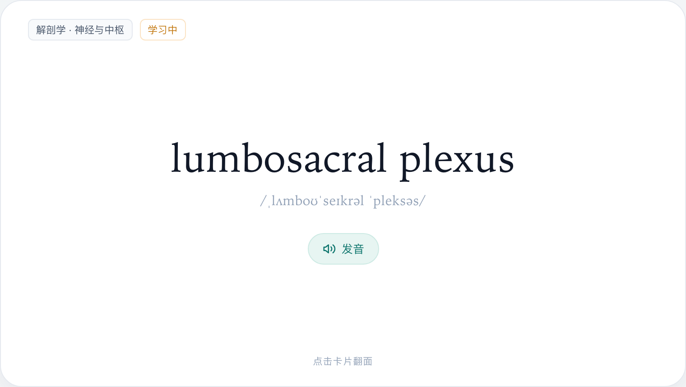
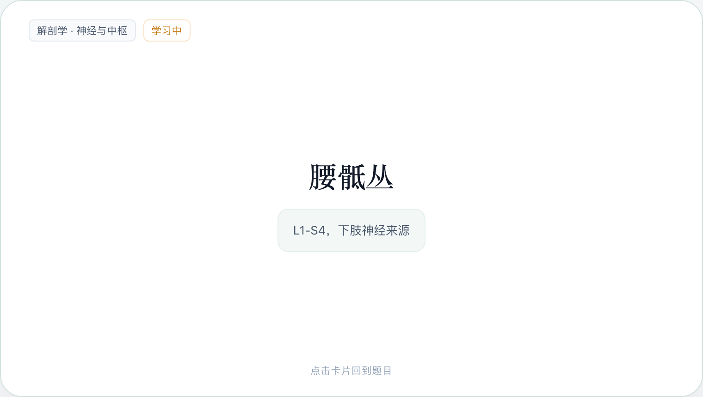
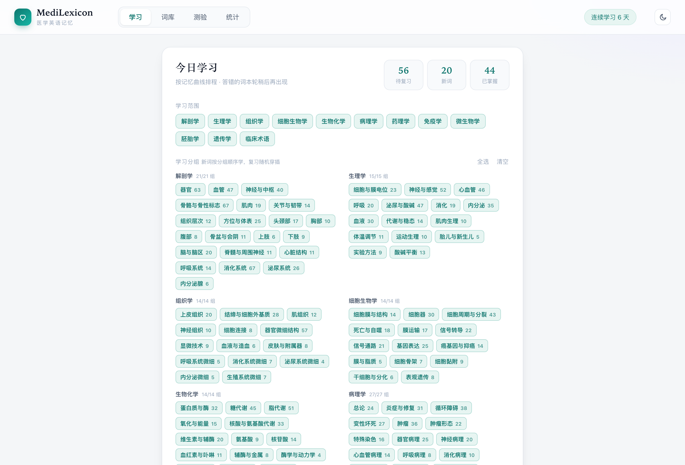
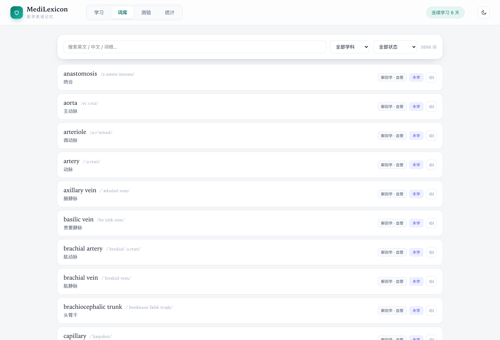
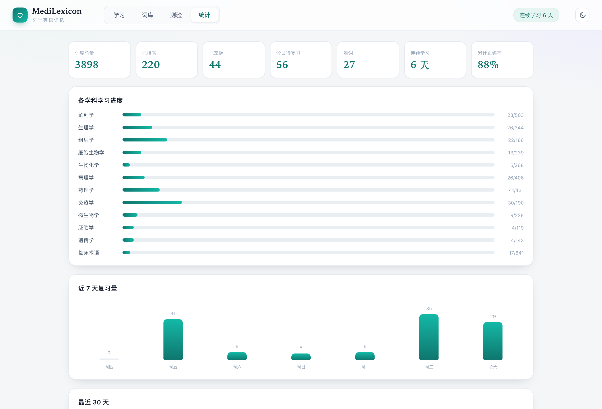
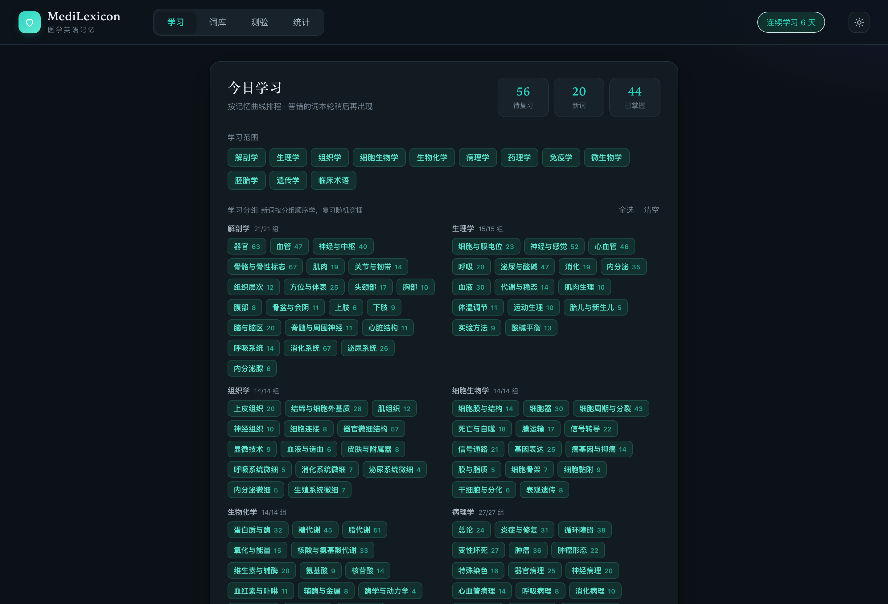

<div align="center">

# 🎓 MedLexicon

**Medical English vocabulary flashcards — 3,898 terms · 12 subjects · 211 subgroups**

A zero-dependency, offline-first web app for learning medical English, built on the SM-2 spaced repetition algorithm.

[English](README.md) · [简体中文](README.zh-CN.md)

[](LICENSE)
[]()
[]()
[]()
[]()

[**Live demo**](https://erdd-chen.github.io/Medlexicon/) · [Features](#features) · [Quick start](#quick-start) · [Vocabulary](#vocabulary)

---




</div>

> **Note:** the interface is currently in Chinese, and every entry pairs an English term with a Chinese gloss. The app is aimed at Chinese-speaking medical students preparing for exams such as USMLE or LMCHK. An English-only gloss mode is on the roadmap.

## Why this exists

Most flashcard decks for medicine are either huge and unsorted, or built for a general English learner. This one is scoped:

- **Medical-specific.** 3,898 terms compiled around high-yield topics in USMLE Step 1/2 and LMCHK, covering anatomy, physiology, pathology, pharmacology, clinical medicine and more.
- **Narrow subgroups.** 12 subjects are split into 211 subgroups, so you can drill something like *antitubercular drugs* or *bone tumors* instead of an entire discipline.
- **Etymology on the back.** Every card carries IPA, a Chinese gloss, and a short word-root note (e.g. `adrenal` = `ad-` near + `renal` kidney).
- **Scheduling that works.** SM-2 with a three-button grade, so reviews land when you are about to forget.
- **No account, no server.** Static files, `localStorage` persistence, opens straight from disk.

## Features

| Area | What it does |
|------|--------------|
| **Study** | SM-2 scheduling; scope a session by subject or subgroup; new terms in order, reviews shuffled |
| **Cards** | Native 3D flip, click or Space/Enter to reveal; Web Speech API pronunciation |
| **Grading** | Again / Hard / Good — drives ease factor, interval and due date |
| **Library** | Full-text search, filter by subject / status / leech, incremental rendering, per-term progress |
| **Quiz** | Term→meaning, meaning→term, spelling and listening modes; keyboard 1–4 to answer, Enter for next |
| **Stats** | Totals, terms seen, mastered, due today, leech count, streak, accuracy, per-subject progress, 7-day bars, 30-day heatmap |
| **Theme** | Light and dark, remembered per browser, synced across tabs |
| **Offline** | Installable PWA with a service worker; the deck works with no network |
| **Sync** | `BroadcastChannel` + `storage` events, merged by timestamp across tabs |
| **Storage** | Everything stays in `localStorage`; export/import JSON for backup |

## Screenshots

**Study setup — pick subjects and subgroups**



**Library — search across all 3,898 terms**



**Stats — progress by subject, 7-day activity, 30-day heatmap**



**Dark theme**



## Quick start

Open the file directly:

```bash
git clone https://github.com/Erdd-chen/Medlexicon.git
cd Medlexicon
open index.html
```

Or serve it locally (recommended, so the speech API and sync behave normally):

```bash
python3 -m http.server 8765
# then visit http://localhost:8765
```

No install, no build step, no dependencies.

## Vocabulary

| Subject | Terms | Subject | Terms |
|---------|-------|---------|-------|
| Anatomy | 503 | Genetics | 143 |
| Physiology | 344 | Clinical | 841 |
| Histology | 186 | Microbiology | 228 |
| Cell biology | 239 | Embryology | 119 |
| Biochemistry | 268 | Immunology | 190 |
| Pathology | 406 | Pharmacology | 431 |

**3,898 terms · 211 subgroups.** The deck is still growing — contributions are welcome.

## Project structure

```
med-vocab/
├── index.html        # Markup and view containers
├── styles.css        # All styling (light/dark tokens, responsive)
├── app.js            # App logic: SM-2, quiz, stats, theme, cross-tab sync
├── words.js          # Vocabulary + subject/group metadata (generated)
├── build.mjs         # Vocabulary build script (Node.js ESM: dedupe, sort, count)
├── manifest.webmanifest
├── sw.js             # Service worker: offline cache
└── icons/            # App icons (192 / 512)
```

### Term format

```js
// [term, IPA, gloss, subject, subgroup, etymology note]
["acetylcholine", "/ˌæsɪtlˈkoʊliːn/", "乙酰胆碱", "physiology", "neuro", "acetyl + choline"]
```

### Rebuilding the deck

```bash
node build.mjs
```

## Tech

Plain HTML5, CSS3 and ES5-era JavaScript. No framework, no bundler, no runtime dependency.

- Scheduling — SM-2 variant with three grades
- Persistence — `localStorage`
- Cross-tab sync — `BroadcastChannel` and `StorageEvent`
- Speech — Web Speech API
- Theming — CSS custom properties, `prefers-color-scheme` aware
- Offline — service worker with precached core assets

## Roadmap

- [ ] Grow the deck toward 5,000 terms
- [x] Dark theme
- [x] Installable PWA with offline cache
- [ ] Frequency and difficulty tiers
- [ ] Import custom word lists
- [ ] English-only gloss mode
- [ ] Yearly activity heatmap

## Data and disclaimer

- Entries were compiled from standard medical textbooks and common terminology; no copyrighted word list or dictionary data was copied.
- IPA transcriptions follow the International Phonetic Alphabet; the Chinese glosses and etymology notes were written for this project.
- SM-2 is a public algorithm; the implementation here is original.
- Intended for study and teaching only. **Not medical advice.**

## Contributing

Bug reports, new terms and feature ideas are all welcome. Please check the term format above before opening a pull request.

## License

[MIT](LICENSE) © 2026 erdd
