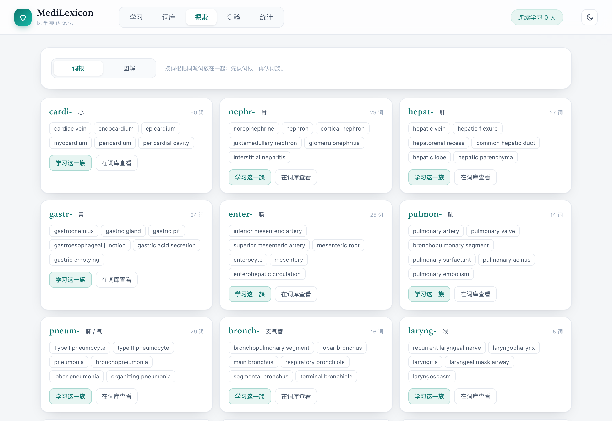
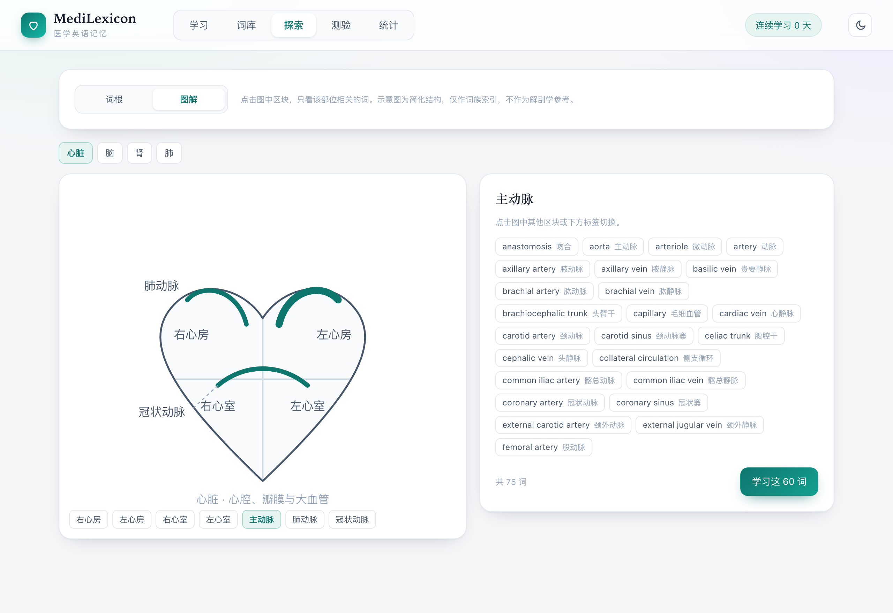
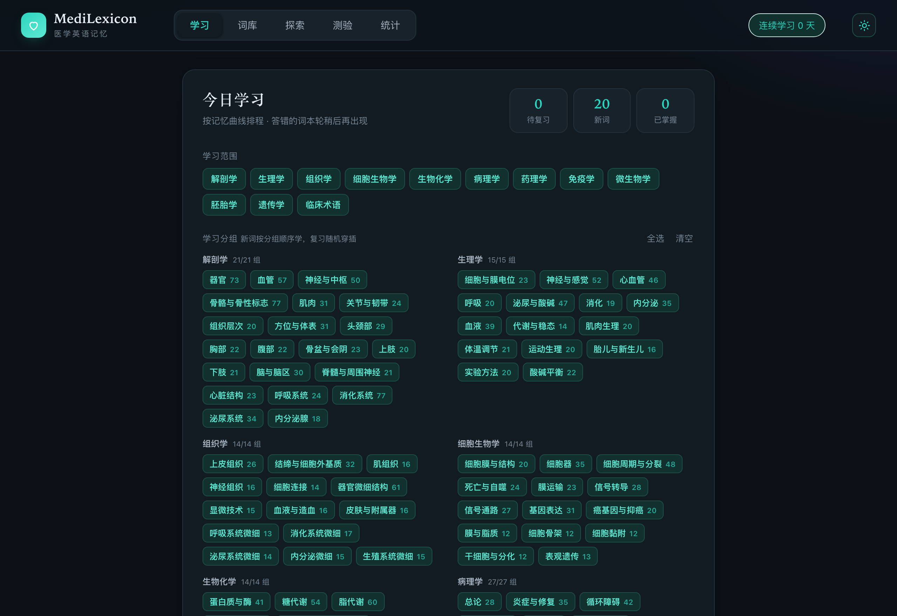

<div align="center">

# 🎓 MedLexicon

**医学英语词汇记忆 · 5,203 词 · 12 学科 · 211 细分小组**

基于 **SM-2 间隔重复算法** 的医学英语单词记忆工具，纯静态、零依赖、可离线。

[English](README.md) · [简体中文](README.zh-CN.md)

[](LICENSE)
[]()
[]()
[]()
[]()

[**在线演示**](https://erdd-chen.github.io/Medlexicon/) · [功能特性](#功能特性) · [快速开始](#快速开始) · [词库覆盖](#词库覆盖)

---


</div>

## 为什么需要 MedLexicon

- **医学专用**：5,203 条词条围绕 USMLE Step 1/2 与 LMCHK 高频考点整理，覆盖解剖、生理、病理、药理、临床等全学科，而非通用英语词汇
- **精细分组**：12 个学科拆成 211 个细分小组（如「药理 → 抗结核药」「病理 → 骨肿瘤」），可按需定向学习，不必一次吞下一个学科
- **词根拆解**：每条词条附带音标、中文释义与词根/记忆点，理解构词逻辑
- **调度有效**：SM-2 三档评分，复习时机落在即将遗忘之前
- **无需账号**：纯静态文件 + `localStorage`，双击即开

## 功能特性

| 模块 | 说明 |
|------|------|
| 学习 | SM-2 调度，按学科/小组选择范围，新词成组学习、复习随机打乱 |
| 卡片 | 原生 3D 翻转，点击或空格/回车翻面；Web Speech API 朗读 |
| 评分 | 不认识 / 模糊 / 认识 三档反馈，驱动 ef、间隔与到期时间计算 |
| 词库 | 全量检索，按学科 / 状态 / 难词筛选，增量渲染，查看单词详情与学习进度 |
| 测验 | 英译中 / 中译英 / 拼写 / 听音 四种题型；键盘 1–4 选项，回车下一题 |
| 探索 | 词根视图按构词法聚合同源词族；图解视图把词条映射到自绘解剖示意图（心、脑、肾、肺），点击区块定向学习 |
| 统计 | 词库总量、已接触、已掌握、今日待复习、难词数、连续天数、累计正确率、各学科进度、7 天柱状图、全年热力图 |
| 自建词表 | 支持导入 CSV/JSON 自定义词表，作为独立学科出现，可随时清空 |
| 主题 | 浅色 / 深色，随系统偏好初始化，按标签页同步 |
| 离线 | 可安装 PWA + Service Worker 预缓存，断网也能背 |
| 同步 | BroadcastChannel + storage 事件双通路，按时间戳合并 |
| 存储 | 全部数据留在 localStorage，可导出 JSON 备份 |

## 界面预览

**学习设置 · 按学科与细分小组组合学习范围**


**词库 · 5,203 词全量检索与进度标记**


**探索 · 词根词族聚类与解剖图解定位**




**统计 · 各学科进度、近 7 天复习量与全年热力图**


**深色主题**



## 快速开始

```bash
git clone https://github.com/Erdd-chen/Medlexicon.git
cd Medlexicon
open index.html
```

或起一个本地静态服务器（推荐，语音与同步表现更正常）：

```bash
python3 -m http.server 8765
# 浏览器访问 http://localhost:8765
```

无需安装依赖，无需构建。

## 词库覆盖

| 学科 | 词数 | 学科 | 词数 |
|------|------|------|------|
| 解剖学 | 727 | 遗传学 | 176 |
| 生理学 | 414 | 临床术语 | 1041 |
| 组织学 | 286 | 微生物学 | 318 |
| 细胞生物学 | 317 | 胚胎学 | 219 |
| 生物化学 | 368 | 免疫学 | 260 |
| 病理学 | 526 | 药理学 | 551 |

**总计 5,203 条词条 · 211 个细分小组**，词库持续扩充中，欢迎通过 Issue / PR 贡献。

## 项目结构

```
med-vocab/
├── index.html        # 页面结构与视图容器
├── styles.css        # 全部样式（明暗主题变量、响应式）
├── app.js            # 应用逻辑：SM-2、测验、探索、统计、主题、跨标签同步
├── words.js          # 词库数据 + 学科/分组元数据（构建产物）
├── build.mjs         # 词库生成脚本（Node.js ESM：合并 seed/、去重、排序、统计）
├── seed/             # 补充词条批次，构建时自动合并
├── manifest.webmanifest
├── sw.js             # Service Worker：离线缓存
└── icons/            # 应用图标（192 / 512）
```

### 词库数据格式

```js
// [英文, 音标, 中文释义, 学科键, 分组键, 词根/记忆点]
["acetylcholine", "/ˌæsɪtlˈkoʊliːn/", "乙酰胆碱", "physiology", "neuro", "乙酰基 + 胆碱"]
```

### 重新生成词库

```bash
node build.mjs
```

## 技术栈

原生 HTML5 + CSS3 + JavaScript，无框架、无打包器、无运行时依赖。

- 调度：SM-2 变体（三档评分）
- 持久化：`localStorage`
- 跨标签同步：`BroadcastChannel` + `StorageEvent`
- 语音：Web Speech API
- 主题：CSS 自定义属性，跟随 `prefers-color-scheme`
- 离线：Service Worker 预缓存核心资源

## 路线图

- [x] 词库扩充至 5,000+
- [x] 暗色主题
- [x] PWA 离线安装
- [ ] 词频与难度分级
- [x] 自定义词表导入
- [ ] 英文释义模式
- [x] 全年学习热力图
- [x] 词根聚类与解剖图解视图

## 数据来源与声明

- 词条依据公开医学教材与通用术语整理，未复制任何受版权保护的词表或词典数据
- 音标采用国际音标（IPA），中文释义与词根拆解为本项目撰写
- SM-2 为公开算法，本项目为独立实现
- 仅用于学习与教学，**不构成医疗建议**

## 贡献

欢迎提交 issue、补充词条或改进功能。提交 PR 前请先确认符合上面的数据格式。

## License

[MIT](LICENSE) © 2026 erdd
