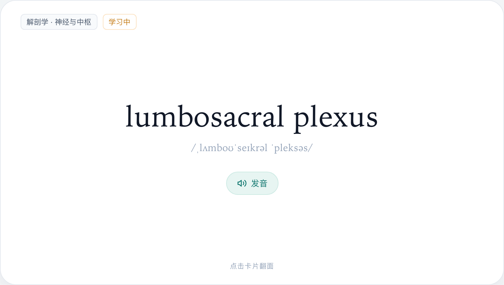
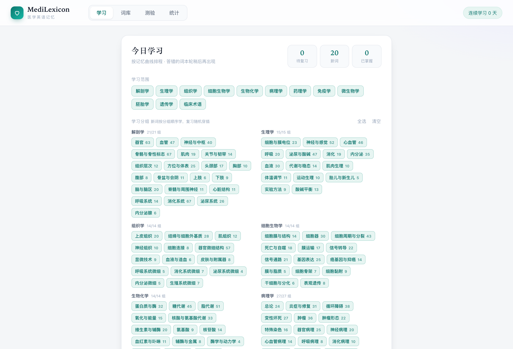
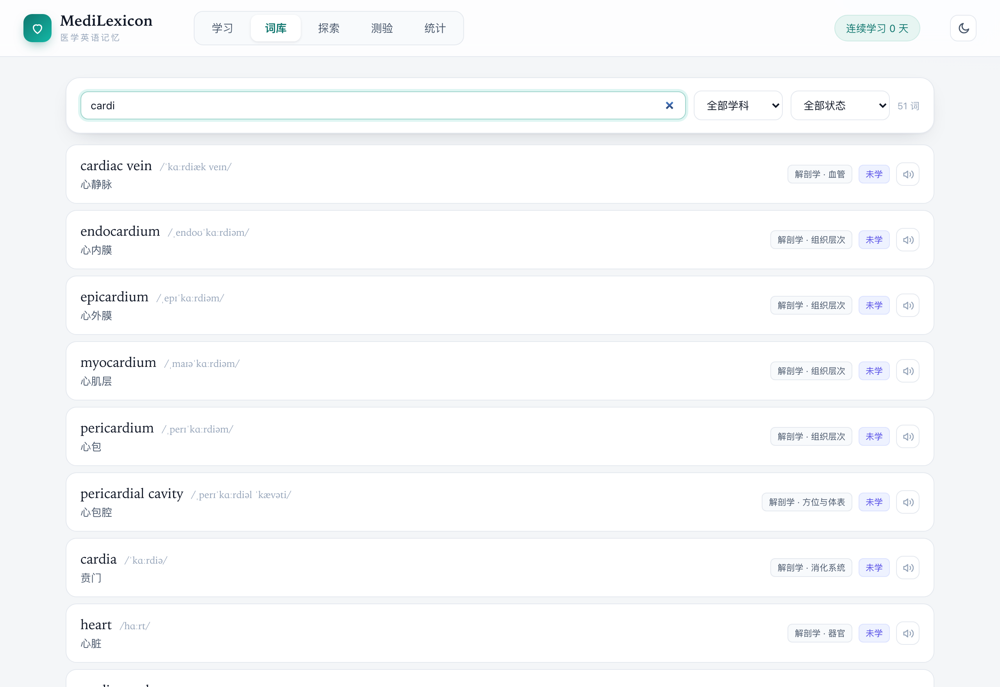
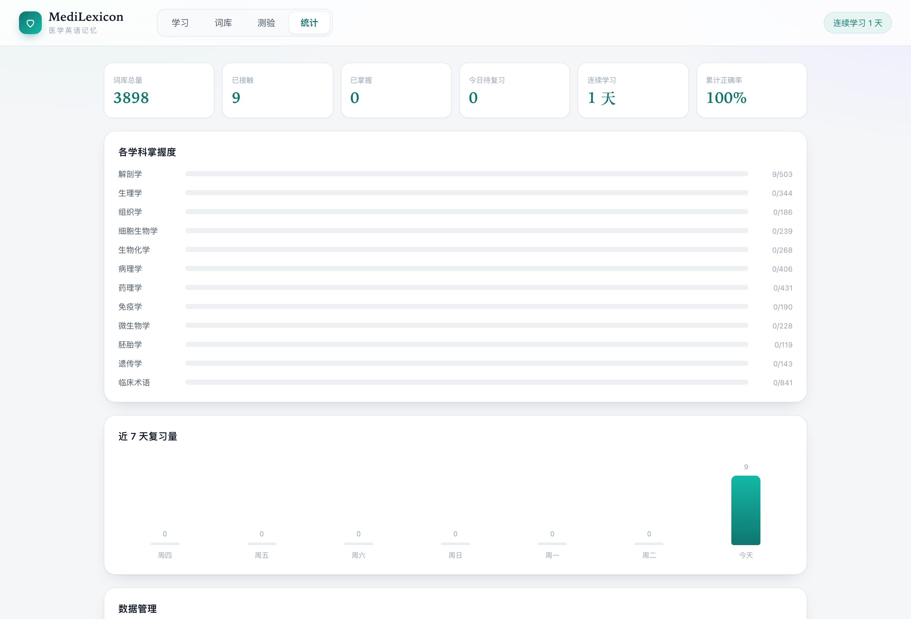

<div align="center">

# 🎓 MedLexicon

**医学英语词汇记忆 · 3,898 词 · 12 学科 · 211 细分小组**

基于 **SM-2 间隔重复算法** 的医学英语单词记忆工具，纯静态、零依赖、可离线。

[English](README.md) · [简体中文](README.zh-CN.md)

[](LICENSE)
[]()
[]()
[]()
[]()

[**在线演示**](https://erdd-chen.github.io/Medlexicon/) · [功能特性](#功能特性) · [快速开始](#快速开始) · [词库覆盖](#词库覆盖)

---




</div>

## 为什么需要 MedLexicon

- **医学专用**：3,898 条词条围绕 USMLE Step 1/2 与 LMCHK 高频考点整理，覆盖解剖、生理、病理、药理、临床等全学科，而非通用英语词汇
- **精细分组**：12 个学科拆成 211 个细分小组（如「药理 → 抗结核药」「病理 → 骨肿瘤」），可按需定向学习，不必一次吞下一个学科
- **词根拆解**：每条词条附带音标、中文释义与词根/记忆点，理解构词逻辑
- **调度有效**：SM-2 三档评分，复习时机落在即将遗忘之前
- **无需账号**：纯静态文件 + `localStorage`，双击即开

## 功能特性

| 模块 | 说明 |
|------|------|
| 学习 | SM-2 调度，按学科/小组选择范围，新词成组学习、复习随机打乱 |
| 卡片 | 原生 3D 翻转，点击或空格/回车翻面；Web Speech API 朗读 |
| 评分 | 不认识 / 模糊 / 认识 三档反馈，驱动 ef、间隔与到期时间计算 |
| 词库 | 全量检索、按学科与小组筛选、查看单词详情与学习进度 |
| 测验 | 英译中 / 中译英 / 拼写 三种题型 |
| 统计 | 词库总量、已接触、已掌握、今日待复习、连续天数、累计正确率、各学科进度 |
| 同步 | BroadcastChannel + storage 事件双通路，按时间戳合并 |
| 存储 | 全部数据留在 localStorage，不上传任何内容 |

## 界面预览

**学习设置 · 按学科与细分小组组合学习范围**



**词库 · 3,898 词全量检索与进度标记**



**统计 · 各学科掌握度**



## 快速开始

```bash
git clone https://github.com/Erdd-chen/Medlexicon.git
cd Medlexicon
open index.html
```

或起一个本地静态服务器（推荐，语音与同步表现更正常）：

```bash
python3 -m http.server 8765
# 浏览器访问 http://localhost:8765
```

无需安装依赖，无需构建。

## 词库覆盖

| 学科 | 词数 | 学科 | 词数 |
|------|------|------|------|
| 解剖学 | 503 | 遗传学 | 143 |
| 生理学 | 344 | 临床术语 | 841 |
| 组织学 | 186 | 微生物学 | 228 |
| 细胞生物学 | 239 | 胚胎学 | 119 |
| 生物化学 | 268 | 免疫学 | 190 |
| 病理学 | 406 | 药理学 | 431 |

**总计 3,898 条词条 · 211 个细分小组**，词库持续扩充中，欢迎通过 Issue / PR 贡献。

## 项目结构

```
med-vocab/
├── index.html        # 页面结构与视图容器
├── styles.css        # 全部样式（CSS 变量主题、响应式）
├── app.js            # 应用逻辑：SM-2、测验、统计、跨标签同步
├── words.js          # 词库数据 + 学科/分组元数据（构建产物）
└── build.mjs         # 词库生成脚本（Node.js ESM：去重、排序、统计）
```

### 词库数据格式

```js
// [英文, 音标, 中文释义, 学科键, 分组键, 词根/记忆点]
["acetylcholine", "/ˌæsɪtlˈkoʊliːn/", "乙酰胆碱", "physiology", "neuro", "乙酰基 + 胆碱"]
```

### 重新生成词库

```bash
node build.mjs
```

## 技术栈

原生 HTML5 + CSS3 + JavaScript，无框架、无打包器、无运行时依赖。

- 调度：SM-2 变体（三档评分）
- 持久化：`localStorage`
- 跨标签同步：`BroadcastChannel` + `StorageEvent`
- 语音：Web Speech API

## 路线图

- [ ] 词库扩充至 5,000+
- [ ] 词频与难度分级
- [ ] 学习数据图表
- [ ] PWA 离线安装
- [ ] 自定义词表导入
- [ ] 暗色主题

## 数据来源与声明

- 词条依据公开医学教材与通用术语整理，未复制任何受版权保护的词表或词典数据
- 音标采用国际音标（IPA），中文释义与词根拆解为本项目撰写
- SM-2 为公开算法，本项目为独立实现
- 仅用于学习与教学，**不构成医疗建议**

## 贡献

欢迎提交 issue、补充词条或改进功能。提交 PR 前请先确认符合上面的数据格式。

## License

[MIT](LICENSE) © 2026 erdd
